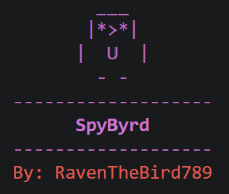

# SpyByrd
BLE + WiFi Scanning Reconnaissance Tool



Requirements:
* Ensure that the latest version of python is installed in your terminal (python 3.9+)
* `bleak` for BLE scanning and `scapy` for WiFi scanning (both are installed from requirements.txt)
* For WiFi scanning: a wireless adapter that supports monitor mode, already switched into monitor mode (ex: `sudo airmon-ng start wlan0`)
* Root privileges (or CAP_NET_RAW) for WiFi packet capture

Recommendations:
* Run the WiFi side on Linux (Kali-Linux works great and comes with `airmon-ng` pre-installed)
* If you're on Windows, use `--no-wifi` since scapy generally can't capture in monitor mode there

Installation & setup

````bash
git clone https://github.com/RavenTheBird789/SpyByrd
cd SpyByrd
python3 -m venv env
source env/bin/activate   # Windows: env\Scripts\activate
pip install -r requirements.txt
````

To run

````bash
python3 passive_scan.py
````

Options

````bash
-d, --duration     Scan time in seconds (default: 30)
--wifi-iface       WiFi interface already in monitor mode (ex: wlan0mon)
--ble-iface        BLE adapter, Linux only (ex: hci0)
--no-ble           Disable BLE scanning
--no-wifi          Disable WiFi scanning
-o, --output       Export results to a CSV file
````

Examples

````bash
# BLE only, 10 seconds
python3 passive_scan.py --no-wifi -d 10

# BLE + WiFi with CSV export (Linux)
sudo python3 passive_scan.py --wifi-iface wlan0mon --ble-iface hci0 -d 20 -o scan.csv
````

Optional shortcut

````bash
alias scan="python3 passive_scan.py"
````

Notes:
* You must pass `--wifi-iface` for WiFi scanning to run, otherwise the WiFi scan is skipped with a message (this is expected, use `--no-wifi` to silence it)
* The interface must already be in monitor mode, the script does not switch it for you
* The WiFi scan is passive and never transmits, but the BLE scan is NOT passive by default (bleak's default mode is "active" and sends scan requests to get device names). Passing `scanning_mode="passive"` to `BleakScanner` makes it listen-only on Windows, needs extra arguments on Linux, and is unsupported on macOS
* KeyboardInterrupt (Ctrl + C) can be used to stop the scan early, the summary will still print and the CSV will still export with whatever was found
* Devices with a blank name are normal, a lot of phones and trackers randomize their addresses and don't advertise a name
* CSV columns are `type, addr, name, rssi, channel, count, last_seen` (`rssi` is the latest reading and `channel` is only filled in for WiFi)
* If no duration is provided, the default is 30 seconds
